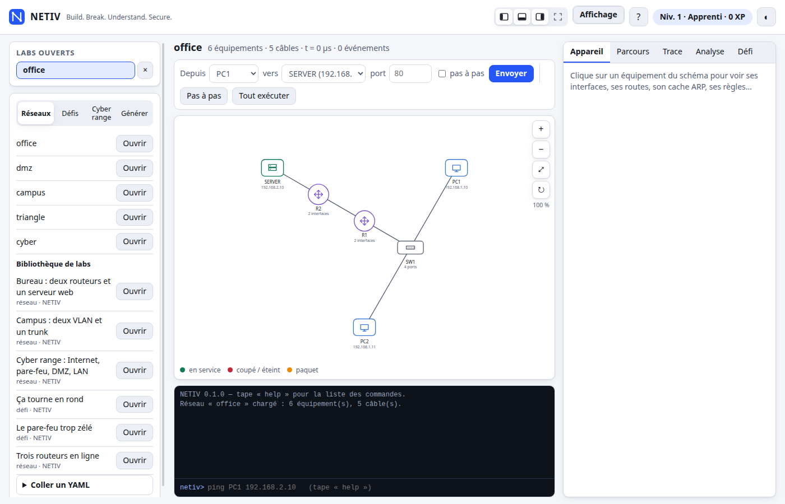

# NETIV — Network Côte d'Ivoire

Laboratoire réseau interactif en Rust : **construire, observer, casser, diagnostiquer**.

> Ne pas seulement montrer qu'un réseau fonctionne, mais comprendre *pourquoi* il fonctionne
> et pourquoi il tombe en panne.

Version **0.4** (phases 0 à 8, éditeur de réseau, DHCP et DNS) — Linux.

**Documentation : [docs/](docs/README.md)** — [guide utilisateur](docs/guide-utilisateur.md) ·
[référence des commandes](docs/reference-commandes.md) · [format des topologies](docs/format-topologie.md) ·
[API](docs/api.md) · [architecture](docs/architecture.md) · [performance](docs/performance.md).
Conception : [cahier des charges](Cahier_de_charge.md) · [spécification d'architecture](SPEC_ARCHITECTURE.md).

## Essayer

```bash
cargo run -p netiv-bin -- run examples/mvp.yaml
```

```
PC1 ── SW1 ── R1 ── R2 ── SERVER
```

```text
netiv> ping PC1 192.168.2.10 2
  seq 1  réponse de 192.168.2.10  ttl=62  temps=16.000 ms   [parcours #1]
  seq 2  réponse de 192.168.2.10  ttl=62  temps=8.000 ms    [parcours #2]

netiv> trace 1            # Packet Journey : tout ce qui s'est passé, dans l'ordre
netiv> inspect 49         # Packet Microscope : une trame, couche par couche
netiv> explain 25         # Explain Engine : pourquoi R1 a choisi cette route
```

Observer pourquoi le 1er ping prend 16 ms et le 2ᵉ 8 ms : le 1er déclenche trois résolutions ARP
(une par segment), le 2ᵉ profite des caches.

### Casser puis comprendre

```text
netiv> gateway PC1 192.168.1.254      # mauvaise passerelle
netiv> ping PC1 192.168.2.10          # → pas de réponse
netiv> trace 1                        # → 3 tentatives ARP sans réponse, puis abandon

netiv> route del R1 192.168.2.0/24    # route manquante
netiv> ping PC1 192.168.2.10          # → « erreur de 192.168.1.1 : réseau inaccessible »

netiv> cable R1 eth1 cut              # câble coupé
netiv> ip PC1 eth0 192.168.1.10/16    # mauvais masque
netiv> loss PC1 eth0 0.3              # 30 % de perte (reproductible grâce à la graine)
```

Pas-à-pas : `ping PC1 192.168.2.10 --step` puis `step` (un événement à la fois) ou `run`.
`help` liste toutes les commandes.

### Autres modes

```bash
netiv validate topologie.yaml                 # erreurs + avertissements, sans lancer
netiv run topologie.yaml --script lab.txt     # exécute des commandes puis quitte
netiv generate --type campus --routers 5 --hosts 20 --seed 1   # topologie générée
netiv docs topologie.yaml --format md         # documentation (md, json, yaml)
netiv serve                                   # API HTTP + interface web sur http://127.0.0.1:8787
crates/netiv-wasm/build-web.sh                # la même interface, sans serveur (WebAssembly) : docs/wasm.md
netiv bench                                   # mesures de performance reproductibles
```

## Ce que contient NETIV

| Phase | Fonctions | Commandes principales |
|---|---|---|
| Moteur | ARP, ICMP, routage, switch + **VLAN** (access/trunk), **UDP**, **TCP minimal** + service HTTP simulé, **pare-feu/ACL** à état, **DHCP** (relais compris), **DNS** | `ping`, `curl`, `udp`, `port`, `service`, `acl`, `dhcp`, `dns`, `nslookup`, `trace`, `inspect`, `explain` |
| 4 · Chaos & dépannage | 21 pannes réversibles (L1/L2/L3/services), diagnostic de cause racine, indices à 4 niveaux | `chaos start`, `diagnose`, `hint`, `baseline` |
| 5 · Éducation | 28 défis (dont 10 tickets de support IT), scoring (diagnostic 40 + correction 40 + temps 20 − indices), XP, niveaux, 6 badges, parcours, mode enseignant | `challenge …`, `answer`, `dashboard`, `badges`, `learn`, `course` |
| 6 · Sécurité | analyseur (SEC-001…011), forensique sur captures `.nlv`, 3 cyber ranges | `security analyze`, `capture save`, `forensic analyze`, `range …` |
| 7 · Intelligence | tuteur scripté, générateurs de topologies et de défis auto-validés, what-if, score de santé, docs | `tutor`, `topology generate`, `challenge generate`, `what-if`, `health`, `docs` |
| 8 · Écosystème (local) | labs partageables `.netiv`, classement local, API HTTP, interface web | `lab list/open/export`, `leaderboard`, `netiv serve` |

Exemples : `examples/*.yaml` ; labs prêts à l'emploi dans `labs/*.netiv`.

### Interface web



`netiv serve` démarre un serveur **local uniquement** (127.0.0.1) : schéma de la topologie,
console, **Packet Journey animé** (◀ ▶ lecture), tables par équipement, trace filtrable,
santé / sécurité / what-if / documentation, défis avec minuteur et indices.

**Mode Construire** (`B`) : dessiner un réseau à la souris (palette, câbles, réglages de chaque
équipement, DHCP et DNS compris), l'adresser automatiquement, annuler/rétablir, télécharger en
`.netiv` — voir le [guide](docs/guide-utilisateur.md#8-construire-un-réseau-dans-le-navigateur).

L'affichage s'adapte à chacun : zones **redimensionnables** (glisser leur bord, ou au clavier),
catalogue / détails / console **repliables** (`[` `]` `` ` ``), mode « schéma seul » (`F`),
schéma **zoomable et déplaçable**, taille du texte et densité réglables (menu *Affichage*), aide
intégrée (`?`). La disposition est mémorisée dans le navigateur. Sans dépendance de build :
HTML/CSS/JS embarqués dans le binaire.

Garde-fous : refus de toute adresse non locale sans `--allow-remote`, contrôle de l'en-tête `Host`,
sessions en mode « bac à sable » (aucun accès fichier arbitraire depuis l'API), corps limité à 1 Mio,
16 labs simultanés au maximum. Tout reste **100 % simulé** : aucune socket réseau réelle n'est ouverte
par la simulation.

### Performance

Le moteur traite environ 800 000 événements par seconde. Les analyses (santé, what-if, sécurité)
lancent leurs sondes **en parallèle** sur des copies légères, sans jamais recopier la trace de la
session. Exemple : 20 000 pings passent de 85 s à 0,45 s, un score de santé après une longue
session de 15 s à 0,16 s. Détails et méthode : [docs/performance.md](docs/performance.md).

### Hors périmètre (assumé)

STP, TUI, export PDF natif (Markdown/JSON/YAML ; PDF via `pandoc`), comptes et
marketplace en ligne, mode « réseau réel ».

## Format de topologie

Référence complète : [docs/format-topologie.md](docs/format-topologie.md) ; exemple :
[examples/mvp.yaml](examples/mvp.yaml). Types : `host`, `server`, `router`, `firewall`, `switch`
(`ports: N` crée `port1..portN`). Câbles : `Équipement:interface`, avec `latency_us` et `loss`
optionnels. Les erreurs de structure bloquent le chargement ; les mauvaises configurations
(IP en double, passerelle hors sous-réseau...) ne sont que des **avertissements**, car un
laboratoire de dépannage contient volontairement des réseaux défectueux.

## Développement

```bash
cargo fmt --all --check
cargo clippy --workspace --all-targets
cargo test --workspace
RUSTDOCFLAGS="-D warnings" cargo doc --workspace --no-deps
UPDATE_GOLDEN=1 cargo test -p netiv-cli --test session    # régénère la sortie de référence
cargo build --release && ./target/release/netiv bench    # mesures de performance
```

Conventions et organisation des tests : [docs/contribuer.md](docs/contribuer.md).

| Crate | Rôle |
|---|---|
| `netiv-core` | Moteur : événements discrets, protocoles, équipements, trace, rendu texte. Aucune dépendance UI/async. |
| `netiv-topology` | YAML → `Simulation`, export, bundles `.netiv`, générateur de topologies |
| `netiv-diagnostics` | Sondes, cause racine, indices |
| `netiv-chaos` | Catalogue de pannes, tirage seedé |
| `netiv-security` | Analyseur, forensique, captures |
| `netiv-analysis` | Accessibilité, what-if, score de santé, documentation |
| `netiv-education` | Défis, scoring, profils, cours, cyber ranges, tuteur |
| `netiv-cli` | Session (REPL), bibliothèque `netiv_cli` |
| `netiv-service` | Logique de l'API sans HTTP (labs, limites, JSON), partagée avec WebAssembly |
| `netiv-api` | API HTTP (axum) + interface web embarquée, fine couche sur `netiv-service` |
| `netiv-wasm` | Moteur dans le navigateur (WebAssembly) : classe JS `NetivEngine`, même API que `netiv serve` |
| `netiv-bin` | Binaire `netiv` (run, validate, generate, docs, serve, bench) |

Le moteur est **déterministe** : même topologie, mêmes commandes, même graine → trace identique.
